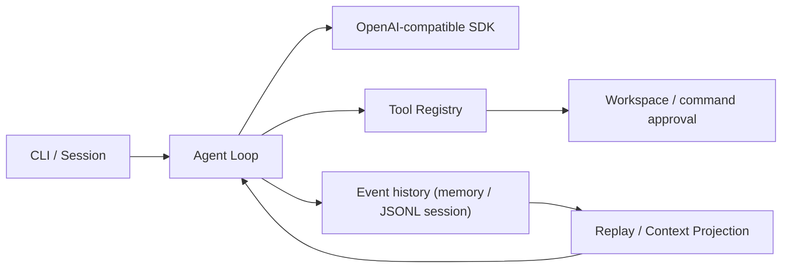

# MiniCodeAgent

MiniCodeAgent 是一个面向本地 Python 项目的轻量 Coding Agent。它通过 OpenAI-compatible Chat Completions 读取和修改代码，经确认执行命令，并把工具结果回填给模型。JSONL 记录让一次会话可以回放、恢复和分叉。

## 核心能力

- 同步 Agent Loop 与原生 Tool Calling，支持六种文件和命令工具。
- 基于 Pydantic 的工具参数校验，以及文件工具的 Workspace 路径边界。
- 持久化会话通过 JSONL Event Store 保存模型尝试、工具结果和轮次终态。
- L1～L4 上下文管理，以及有界请求、工具执行和异常恢复。
- Project Memory 读取工作区根的 `AGENTS.md`，将项目约定作为模型上下文。
- Python Environment Discovery 识别项目解释器，并在用户确认后探测 Python 版本与 pytest 是否可用。



## 安装与快速开始

使用 Python 3.11+，在项目根运行 `python -m venv .venv`。PowerShell 用 `.venv\Scripts\Activate.ps1` 激活，POSIX shell 用 `source .venv/bin/activate`。激活后运行以下命令。

```sh
python -m pip install -e '.[test]'
python -m minicodeagent --help
```

帮助、会话创建和测试可以离线运行。

## 模型配置

模型任务读取当前 Shell 的环境变量。[`.env.example`](.env.example) 只列出配置项，程序不会自动加载 `.env`。

**PowerShell**

```powershell
$env:MINICODEAGENT_API_KEY = [System.Net.NetworkCredential]::new('', (Read-Host '模型 API Key' -AsSecureString)).Password
$env:MINICODEAGENT_MODEL = Read-Host '模型 ID'
$env:MINICODEAGENT_BASE_URL = Read-Host '兼容 API Base URL（使用默认端点时直接回车）'
```

**Bash**

```bash
read -rsp '模型 API Key: ' MINICODEAGENT_API_KEY
printf '\n'
read -rp '模型 ID: ' MINICODEAGENT_MODEL
read -rp '兼容 API Base URL（使用默认端点时直接回车）: ' MINICODEAGENT_BASE_URL
export MINICODEAGENT_API_KEY MINICODEAGENT_MODEL MINICODEAGENT_BASE_URL
```

Base URL 留空时使用 `https://api.openai.com/v1`。使用其他 OpenAI-compatible 服务时输入其 Base URL 和模型 ID。

## CLI

从项目根复制修复示例，避免修改仓库里的演示原件。

```sh
python -c "import shutil; shutil.copytree('examples/bugfix', '.mca-work/bugfix')"
```

如果 `.mca-work/bugfix` 已存在，请换一个新的目标目录（如 `.mca-work/bugfix-2`），并在后续命令中使用同一路径。

普通运行把对话保存在进程内。`--message` 执行一次任务，省略它则进入交互模式。退出后，普通运行的对话不会出现在会话列表中。

```sh
python -m minicodeagent --workspace .mca-work/bugfix --message "定位失败测试，修复实现并运行回归"
```

命令执行前，CLI 展示实际 cwd 与 argv，并请求单次确认。获批命令使用当前 OS 账户的权限。[示例说明](examples/bugfix/README.md)

## Session Resume 和 Fork

需要跨进程继续任务时，先用 `new` 创建会话，再用 `resume --message` 在同一会话中执行任务。此路径会把事件写入指定数据目录。

**PowerShell**

```powershell
$session = python -m minicodeagent new --workspace .mca-work/bugfix --data-root .mca-sessions
python -m minicodeagent resume $session --data-root .mca-sessions --message "定位失败测试，修复实现并运行回归"
python -m minicodeagent list --data-root .mca-sessions
python -m minicodeagent fork $session --data-root .mca-sessions
```

**Bash**

```bash
session=$(python -m minicodeagent new --workspace .mca-work/bugfix --data-root .mca-sessions)
python -m minicodeagent resume "$session" --data-root .mca-sessions --message "定位失败测试，修复实现并运行回归"
python -m minicodeagent list --data-root .mca-sessions
python -m minicodeagent fork "$session" --data-root .mca-sessions
```

`resume --continue` 用于恢复未完成的轮次，并继承剩余请求额度。工具结局不明时，先核对副作用再确认记录。Fork 默认共享工作区，可用 `--workspace` 指向另一已准备好的目录。

## Context Management

以下命令适用于上下文窗口为 32,768 tokens 的模型。使用其他模型时，请按服务商为实际模型公布的窗口调整第一个数值。

```sh
python -m minicodeagent --workspace .mca-work/bugfix --compact-context 32768 2048 --message "检查示例的回归测试"
```

`--compact-context WINDOW OUTPUT_RESERVE` 启用 L1～L4。运行时使用启发式 Token 估算，服务商的实际计数可能不同。`OUTPUT_RESERVE` 从本地输入预算中预留输出空间，主请求的 SDK `max_tokens` 不由此参数设置。[分层处理与恢复](ARCHITECTURE.md)

## 测试与目录

```sh
python -m pytest -q
```

测试使用临时工作区和 Fake SDK，覆盖 Agent Loop、工具、会话与上下文恢复。

| 路径 | 内容 |
| --- | --- |
| `src/minicodeagent/` | CLI、运行时、工具、事件与上下文 |
| `tests/` | 单元与集成回归 |
| `examples/bugfix/` | 小型修复示例 |

## 来源与许可

感谢 [FirstCoder](https://github.com/KomorGiaoGiao/FirstCoder) 提供架构研究参考。 [第三方声明和许可](THIRD_PARTY_NOTICES.md)

MiniCodeAgent 自身的项目许可证待维护者确认。
